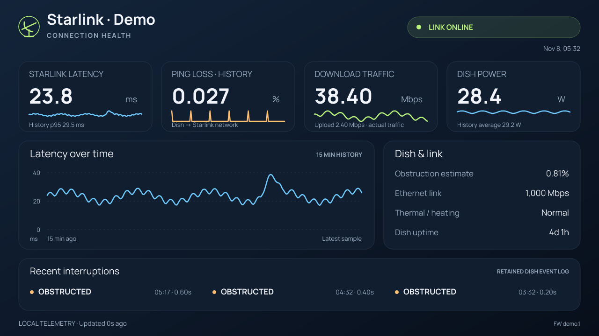

# Homebridge Starlink

Starlink connection-health sensors and a graphical telemetry camera in Apple Home. Runs locally as a Homebridge platform plugin, including as a child bridge. It reads the dish's gRPC API; no Starlink cloud account, API key, Python runtime, Home Assistant, or separate camera plugin is required.



## What appears in Apple Home

| Accessory | Meaning |
| --- | --- |
| **Starlink Outage** | The dish reports a disconnected state continuously for the configured confirmation time. |
| **Starlink Degraded** | Sustained high ping loss, high 95th-percentile latency, or a thermal/slow-Ethernet performance alert. |
| **Starlink Monitor Unreachable** | The plugin cannot obtain fresh dish telemetry. This is separate from a confirmed Internet outage. |
| **Starlink Dashboard** | A camera snapshot and live video view of latency, loss, download/upload traffic, power, dish health, and recent interruptions. |

The three health accessories are read-only **contact sensors**: **Open = problem**, **Closed = clear**. Apple Home uses its normal contact-sensor labels and room status summaries; it does not have a native network-health accessory type. Enable notifications in each sensor's **Status and Notifications** settings, or use the sensors to trigger automations. A home hub is needed for normal remote Home access and automations.

When telemetry becomes stale, the outage/degraded sensors report a fault and preserve the last known alarm state. A failed API request never asserts a Starlink Internet outage. The dashboard remains viewable and explicitly labels old readings as stale.

## Requirements

- Homebridge **1.8+ or 2.x**; Node.js **22.12+, 24, or 26**. Development and integration tests use Homebridge 2.5.
- The **Homebridge host**, not just your phone or Mac, must be able to reach `192.168.100.1:9200`.
- For the camera, FFmpeg with **libx264, MJPEG input, RTP, and SRTP**. The optional `ffmpeg-for-homebridge` dependency supplies a binary on supported platforms. If it is unavailable, the plugin tries `ffmpeg` on `PATH`; an explicit path can be set in the UI. Sensors and JPEG snapshots do not depend on FFmpeg.

With multiple WANs, configure your router to send `192.168.100.1/32` to the actual Starlink WAN. A default route through an arbitrary load-balanced WAN is insufficient.

Check for device-specific routing policies as well: a rule forcing the Homebridge host through another WAN may override a dish route that applies to all clients. In that case, add a specific policy for **Homebridge host → 192.168.100.1 → Starlink WAN**, preserving the host's normal Internet routing.

## Install from npm

The package name is **`@wcoekaer/homebridge-starlink`**. Search for that full name in the Homebridge UI, or run this in the terminal for your Homebridge installation:

```sh
npm install -g @wcoekaer/homebridge-starlink
```

Restart Homebridge, then configure the Starlink platform and its child bridge as described below.

## Install from a release archive

Download the `.tgz` asset from [GitHub Releases](https://github.com/wcoekaer/homebridge-starlink/releases), or build an installation archive locally:

```sh
cd ~/homebridge-starlink
npm ci
npm test
npm pack
```

Copy `wcoekaer-homebridge-starlink-0.1.2.tgz` onto the machine running Homebridge. In a terminal for that Homebridge installation (the Homebridge UI terminal works for standard installations):

```sh
npm install -g /absolute/path/wcoekaer-homebridge-starlink-0.1.2.tgz
```

Use the same Node/npm environment and permissions as the Homebridge service. In Docker, install inside the persistent Homebridge container environment, not on the Docker host. The archive includes compiled JavaScript, the telemetry schema, fonts, and the settings UI schema; development dependencies are not needed on the target host.

For upgrades within the scoped package, install the new version and restart the Starlink child bridge. For the original unscoped 0.1.0/0.1.1 package, follow the migration steps below.

Recent npm versions can require approval for dependency install scripts. If bundled FFmpeg was not downloaded, follow npm's install-script approval prompt for `ffmpeg-for-homebridge`, or install a suitable system FFmpeg and set its path. Do not disable all script protections globally.

For local development on a machine that also runs Homebridge, `npm link` from this repository is an alternative to installing the archive. Rebuild and restart the plugin's child bridge after source changes.

## Migrate from the original unscoped package

Version 0.1.2 changes the npm package name from `homebridge-starlink` to `@wcoekaer/homebridge-starlink`. Install the scoped package, remove the old package, and then restart Homebridge. **Do not restart between installing the new package and removing the old one.** For an archive installation:

```sh
npm install -g /absolute/path/wcoekaer-homebridge-starlink-0.1.2.tgz
npm uninstall -g homebridge-starlink
```

Keep the existing `Starlink` platform configuration and `_bridge` settings. If your Homebridge config has a `plugins` allowlist, replace `homebridge-starlink` there with `@wcoekaer/homebridge-starlink`. The platform alias and accessory UUIDs are unchanged, allowing Homebridge to migrate the cached accessories and retain HomeKit pairing, rooms, and automations. Do not remove the bridge from Apple Home or clear its accessory cache.

## Configure and pair as a child bridge

1. Restart Homebridge after installing the plugin.
2. Open **Plugins → Homebridge Starlink → Settings**. The included config UI groups connection details, health sensors, camera options, alert thresholds, and advanced settings.
3. Keep the default dish address or enter your address. Camera and all three sensors are enabled by default. Save.
4. From the plugin's menu, choose **Set Up Child Bridge** / **Child Bridge Config**. Let Homebridge generate a unique bridge identifier and port, then restart.
5. Open the child bridge's pairing QR code. In Apple Home, use **Add Accessory**, scan that code, and add the bridge and its accessories. Assign the dashboard and sensors to the same room.

The camera is bridged alongside the sensors, so it does not require a separate camera pairing. This plugin supports HomeKit live snapshots and streaming, **not HomeKit Secure Video recording**, microphone audio, or Matter camera bridging. Use a HomeKit child bridge.

For manual configuration, merge the platform object from [examples/config.json](examples/config.json) into your `platforms` array. Change the example `_bridge.username` and port if they are already used. The `_bridge` configuration is managed by Homebridge, not by the plugin.

```json
{
  "platform": "Starlink",
  "name": "Starlink",
  "host": "192.168.100.1",
  "camera": {
    "enabled": true,
    "name": "Starlink Dashboard"
  }
}
```

## Defaults and alert behavior

| Setting | Default | Meaning |
| --- | --- | --- |
| `pollIntervalSeconds` | 5 | Delay between status polling cycles; requests never overlap. |
| `historyIntervalSeconds` | 30 | Refresh the dish's circular performance history. |
| `timeoutSeconds` | 5 | Deadline for each dish request. |
| `staleAfterSeconds` | 30 | Age at which status becomes unknown. Must be at least twice the polling interval. |
| `outageDelaySeconds` | 30 | Disconnected state must persist this long before opening the Outage sensor. |
| `degradedDelaySeconds` | 120 | Poor quality must persist this long before opening the Degraded sensor. |
| `recoveryDelaySeconds` | 30 | Healthy state must persist this long before clearing an alarm. |
| `qualityWindowSeconds` | 60 | Most recent history samples used for quality evaluation. |
| `lossThresholdPercent` | 2 | Mean ping loss that qualifies as degraded. |
| `latencyThresholdMs` | 150 | 95th-percentile latency that qualifies as degraded. |
| `camera.maxStreams` | 2 | Maximum simultaneous live viewers; configurable from 1 to 4. |
| `camera.ffmpegPath` | blank | Override automatic FFmpeg selection. |

Recent history is preferred for quality decisions. If history is absent or stale but status is live, current status values are used instead. A dish reboot discards the previous history. Confirmation timers reset when telemetry is unknown. Normal brief satellite handovers or subsecond obstructions should not generate an alert for every event.

The Degraded sensor also covers thermal throttling and slow-Ethernet performance alerts. It is suppressed as a new condition while the dish is disconnected; an already-active alarm still observes its recovery delay.

## Reading the dashboard

- **Latency** is dish-to-Starlink-network ping time, not LAN ping or end-to-end latency to a website. The main value is current; the smaller p95 value summarizes available history.
- **Ping loss** is the mean of the dish's ping-drop samples over the displayed history, not an outage count.
- **Download and upload** are traffic actually being carried, not a speed test or estimate of available bandwidth.
- **Power** uses the reported dish supply power, with history as a fallback. It is not necessarily AC wall consumption.
- **Obstruction estimate** describes the dish's estimate of obstructed sky, not the percentage of time offline.
- **Recent interruptions** come from the retained event log; this can cover a different period than the performance graph. Times use the Homebridge host's time zone.
- Performance history normally contains up to **900 one-second samples**. The plugin does not create a long-term telemetry database. Missing samples are not filled with zero and full-loss samples are omitted from latency statistics.

The dashboard image refreshes when data changes, with up to five seconds of image caching. The live camera sends a low-rate image feed encoded as standard H.264 video. Snapshot refresh timing in the Home app is controlled by Apple Home. No HTTP dashboard server or public listening endpoint is opened by the plugin; live video uses HomeKit-negotiated encrypted SRTP.

## Preview and diagnose

Generate a dashboard with synthetic data, without contacting a dish:

```sh
npm run preview -- --demo
```

Read the local dish and render a real dashboard:

```sh
npm run probe
npm run preview -- --host 192.168.100.1 --output artifacts/dashboard-live.png
```

The probe outputs a small summary without dish/account identifiers or GPS coordinates. The preview writes PNG and SVG files. For a different gRPC port, configure the plugin's `port` setting; the CLI uses the standard port 9200.

If the camera tile has an image but live view fails, update to 0.1.1 or later, then check the Homebridge log for camera startup errors, FFmpeg availability, and UDP connectivity between Homebridge and your HomeKit viewer/home hub. The snapshot is a JPEG and can work even when the separate video stream cannot start.

If the dashboard renders with empty telemetry or the sensors become unavailable, run this from the **Homebridge UI terminal** (inside the container if applicable):

```sh
nc -vz -w 5 192.168.100.1 9200
node "$(npm root -g)/@wcoekaer/homebridge-starlink/dist/cli.js" probe
```

The first command checks TCP reachability; the second reads actual telemetry with the installed plugin. Verify the host's route to the dish if the TCP test fails. Check the reported gRPC error if TCP connects but the probe fails. The stale warning includes the last telemetry error; Homebridge debug logging shows individual read failures.

## Development and verification

```sh
npm ci
npm test
npm run test:child-bridge
npm pack --dry-run
```

Tests cover circular-history ordering, missing values, alert/recovery delays, stale telemetry, reboot handling, JPEG rendering, a real local gRPC server, Homebridge accessory creation/cache restoration, encrypted RTP streaming, stream reconfiguration, and encoder cleanup. Network tests require permission to open localhost sockets. A real Apple Home pairing and remote-home-hub playback should still be checked on the target installation; automated packet tests do not replace that step.

The checked-in protobuf schema contains only `get_status` and `get_history` request fields. It was extracted from a Performance dish running firmware `2026.10.17.mr89322.2`. Other hardware/firmware may omit metrics or change the local API; unavailable fields display as unknown. There are no reboot, stow, configuration-write, or router-write operations in this plugin.

## Publishing a GitHub release

Update the package version and lockfile, add release notes at `releases/vX.Y.Z.md`, and commit the changes. Push an annotated `vX.Y.Z` tag matching the package version to publish a release. The release workflow tests the plugin and child bridge, builds the installable `.tgz`, and attaches it with a SHA-256 checksum. It does not publish to npm.

## License

MIT. Bundled Manrope fonts use the SIL Open Font License; see [THIRD-PARTY-NOTICES.md](THIRD-PARTY-NOTICES.md). This is an independent project, not affiliated with SpaceX, Starlink, Apple, or the Homebridge project.
